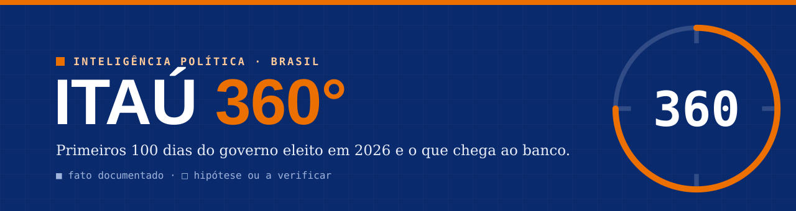

<div align="center">



<br><br>

**O que o governo eleito em 2026 pode fazer nos primeiros 100 dias, e como isso chega ao banco.**
<br>
Funding, crédito, clientes. Cada afirmação com fonte e grau de certeza.

<br>

[](https://sprint-itau-360.vercel.app)


</div>

<br>

## O produto

Site de **inteligência política** para quem decide dentro do banco. Em vez de opinião, entrega um mapa: quais temas do novo governo importam, quem são os atores, que cenários são plausíveis e por qual canal cada um toca o Itaú.

Trabalho de sprint da faculdade (IDP, Sprint 2026.2). O conteúdo vem dos documentos em [`public/docs/`](public/docs) e de fontes públicas linkadas em cada página.

<table>
<tr>
<td width="62%" valign="top">

### O que tem lá dentro

- **5 eixos temáticos**: fiscal, tributário, desenvolvimento produtivo, tecnologia, infraestrutura e transição energética
- **3 cenários** (A, B, C), com sinais para acompanhar
- **Atores** com perfil, papel e fonte da informação
- **Mapa de riscos e oportunidades** por canal de transmissão
- **Sinais a monitorar**, método e lista de fontes
- **Área editorial** com login, para escrever e importar dossiês (`.json`, `.csv`, `.xml`)
- **Uly**, a mascote-guia: dá dicas e curiosidades verificáveis

</td>
<td width="38%" align="center" valign="middle">


<sub>Uly, a mascote-guia</sub>

</td>
</tr>
</table>

## A regra que manda em tudo

Toda afirmação tem fonte e um dos três graus de certeza, **nunca misturados**:

| Selo | Grau | Exemplo |
|:---:|---|---|
| ■ | **Fato documentado** | Cargo oficial, resultado do TSE |
| □ | **Nome cotado ou noticiado** | Rafael Fonteles na Fazenda |
| ┄ | **Hipótese** | Cenários A, B e C |

Sem probabilidade numérica inventada: cenários usam *plausibilidade qualitativa*. O que não tem fonte confiável vai para "Pontos ainda a verificar". Posição de ator só entra com declaração ou voto documentado.

## Acesso e papéis

O site abre **sem login**, somente leitura, mostrando só dossiês publicados. Com login há três papéis, impostos no banco por RLS e gatilhos:

| Papel | Pode |
|---|---|
| **admin** | Gerenciar usuários, papéis e conteúdo |
| **editor** | Criar, editar, apagar e importar conteúdo |
| **observador** | Só ler, inclusive rascunhos |

Conta nova nasce observador. Ninguém muda o próprio papel nem se desativa, e toda mudança de papel vai para a auditoria (`role_audit`).

## Rodando local

Precisa de Node 18+ e um projeto Supabase.

```bash
git clone https://github.com/MatheusCoelho13/Sprint-Itau-360.git
cd Sprint-Itau-360
npm install
cp .env.example .env     # preencha as duas variáveis
npm run dev
```

```env
VITE_SUPABASE_URL=https://SEU-REF.supabase.co
VITE_SUPABASE_PUBLISHABLE_KEY=sb_publishable_...
```

> Sem `.env` o site ainda abre, só com o conteúdo-base de `src/data.ts`.
> Nunca ponha a `secret key` (`sb_secret_...`) no front-end.

**Banco de dados**

```bash
npx supabase login
npx supabase link --project-ref SEU-REF
npx supabase db push --remote
```

Depois, em *Authentication → Providers → Email*, desligue **Allow new users to sign up** e crie os usuários em *Authentication → Users*. O primeiro admin se define no SQL Editor:

```sql
update public.profiles set role = 'admin' where email = 'voce@exemplo.com';
```

| Comando | Faz |
|---|---|
| `npm run dev` | servidor de desenvolvimento |
| `npm run build` | checagem de tipos + build em `dist/` |
| `npm run preview` | serve o build local |

## Estrutura

```
├── index.html          casca do app, telas e painel de login
├── src/
│   ├── main.ts         auth, navegação, eventos
│   ├── ui.ts           renderização das telas
│   ├── data.ts         conteúdo-base: temas, cenários, atores, riscos
│   ├── store.ts        acesso ao Supabase + cache
│   ├── editor.ts       área editorial
│   ├── importer.ts     importação .json / .csv / .xml
│   ├── users.ts        usuários e acesso (admin)
│   ├── mascot.ts       Uly
│   └── style.css       todo o CSS, tokens em :root
├── supabase/
│   ├── migrations/     schema, papéis, usuários
│   └── seed.sql        usuários e dossiês de teste (só banco local)
├── public/
│   ├── docs/           PDFs e DOCX citados nas páginas
│   └── uly/            poses da mascote
└── legacy/             versão original em arquivo único
```

Vite + TypeScript, **sem framework**: as telas são template strings.

## Identidade visual

Página branca, tinta `#0b1220`, azul Itaú `#0a2a6e`. O laranja `#ec7000` aparece só como sinal: número do menu, marcador de editoria, o arco do logo. Títulos em Archivo Narrow, texto corrido em Source Serif 4, dados em IBM Plex Mono. Sem sombras, cantos retos.

## Aviso

Projeto acadêmico e de demonstração. **Não tem vínculo com o Itaú Unibanco** nem representa posição da instituição. Fotografias vêm de páginas externas; confira os direitos de reutilização antes de publicar.

## Licença

[Apache 2.0](LICENSE)

<div align="center">
<br>

<br>
<sub>Feito por <a href="https://github.com/MatheusCoelho13">Matheus Coelho</a> e equipe · Sprint 2026.2</sub>
</div>
